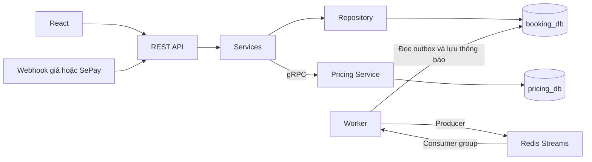

# SmartBooking — rà soát chức năng và luồng demo

Bản demo dùng Docker Compose tại [SmartBooking](http://localhost:5173). [Swagger](http://localhost:5045/swagger) cung cấp tài liệu API và thử các route có JWT. SePay được mô phỏng bằng script local.

## Luồng nghiệp vụ

1. Admin tạo chi nhánh và gán Manager. Admin hoặc Manager phụ trách có thể thêm sân theo nhu cầu.
2. Manager chỉ nhìn thấy chi nhánh được gán. Manager có thể đổi tên hoặc ngừng nhận lịch cho một sân, quản lý bảng giá theo ngày hiệu lực và xem lịch của chi nhánh.
3. User tìm chi nhánh, chọn sân và khung giờ theo giờ Việt Nam. Booking API gọi Pricing Service qua gRPC để lấy giá. Slot dài 60 phút và phải nằm trong giờ mở cửa.
4. API ghi booking `PendingPayment` và khoản cần thu trong cùng transaction. Giữ tối đa 10 phút hoặc tới giờ đá nếu sớm hơn. MySQL chặn hai lịch cùng giữ một sân và giờ.
5. Bản demo nhận webhook giả từ `pwsh -File ./scripts/demo.ps1 -BookingId <id>`. Backend xác thực webhook, đối chiếu tài khoản nhận, mã và số tiền. Khi hợp lệ, API chuyển payment thành `Paid`, booking thành `Confirmed` và ghi outbox.
6. Worker phát outbox lên Redis Streams, nhận sự kiện qua consumer group, lưu thông báo rồi xác nhận đã xử lý. Worker cũng giải phóng giữ chỗ quá hạn và hoàn tất lịch đã qua giờ.
7. Giao dịch sai tiền hoặc đến khi lịch đã đóng được giữ để Admin đối soát. User có thể hủy trực tiếp giữ chỗ đang chờ thanh toán.

## Hai database MySQL

| Schema | Bảng và trách nhiệm |
|---|---|
| `booking_db` — 9 bảng | `users`, `branches`, `branch_managers`, `pitches`, `bookings`, `payments`, `payment_receipts`, `outbox_messages`, `notifications`. |
| `pricing_db` — 1 bảng | `pricing_policies` lưu giá thường, giá cao điểm, giờ cao điểm và ngày hiệu lực theo chi nhánh. |

- `branches` có thể có nhiều `pitches`. Mỗi cặp chi nhánh và số sân là duy nhất. `branch_managers` giới hạn một Manager mỗi chi nhánh và một chi nhánh mỗi Manager.
- `bookings` nối User với sân. Unique index trên sân và giờ đang chiếm chỗ ngăn đặt trùng ngay cả khi hai yêu cầu đồng thời. Lịch hủy và hết hạn được giữ để tra lịch sử.
- `payments` có một khoản cần thu trên mỗi booking và mã thanh toán duy nhất. `payment_receipts.sepay_id` chống ghi nhận một giao dịch hai lần. Thông báo duy nhất theo cặp sự kiện và người nhận.
- `pricing_policies` duy nhất theo chi nhánh và ngày hiệu lực. Hai schema dùng ID tham chiếu logic qua gRPC, còn booking lưu giá đã chốt để lần đổi giá tiếp theo không đổi lịch cũ.
- MySQL lưu mốc đặt sân theo UTC và React hiển thị theo giờ Việt Nam. Compose khởi tạo hai tài khoản DB riêng cho Booking và Pricing.

## Lỗi và điểm đã sửa

| Phát hiện | Cách xử lý |
|---|---|
| Slot hết hạn có thể còn bị chặn cho tới chu kỳ Worker tiếp theo | Danh sách giờ trống bỏ qua giữ chỗ hết hạn. API đặt lại khóa lịch cũ, giải phóng lịch và payment rồi tạo lượt giữ mới trong cùng transaction. |
| Cấu hình demo hiển thị QR của tài khoản giả. Khi thiếu cấu hình, API vẫn có thể giữ sân | Demo hiện trạng thái giao dịch mô phỏng và không tạo QR chuyển khoản. Thiếu cấu hình thanh toán trả HTTP 503 trước khi tạo lượt giữ. |
| Đổi ngày hoặc giờ có thể thấy giá của lựa chọn cũ trong lúc tải | Dữ liệu hiển thị gắn với lựa chọn hiện tại. Nếu API trả 409 vì người khác đặt trước, giao diện tải lại giờ trống. |
| Đăng nhập từ bước đặt sân làm mất lựa chọn | Giữ chi nhánh, sân, ngày và giờ qua bước đăng nhập. Khi phiên hết hạn, giao diện đưa về màn hình đăng nhập. |
| Theo dõi thanh toán có thể dừng sau lỗi mạng, thông báo giới hạn ở trang đầu | Trang chi tiết thử tải lại khi lỗi mạng hoặc lỗi server. Thông báo có phân trang. |
| Công cụ kiểm tra phụ thuộc báo cảnh báo Vite và MySqlConnector | Cập nhật Vite lên 6.4.6 và MySqlConnector lên 2.6.1. |

## Giới hạn của bản demo

- Webhook đã kiểm tra bằng giao dịch giả. Chưa xác minh giao dịch SePay Live hoặc chuyển tiền thật.
- Giao dịch sai số tiền hoặc đến muộn cần Admin xử lý đối soát. Bản hiện tại chưa tự hoàn tiền hoặc hủy lịch đã thanh toán.
- Kiểm thử đồng thời tập trung vào hai yêu cầu cùng slot. Chưa đo tải diện rộng.
- Trước khi nộp, điền tên thành viên và phần việc thực tế trong README. Xem [checklist theo đề](CHECKLIST-DEMO.md).

## Giao diện

React dùng Lucide cho điều hướng, trạng thái và nút thao tác. Trang tìm sân có ảnh hero WebP trong `SmartBooking-Football-FE/src/assets/pitch-hero.webp`. Ảnh tạo bằng ImageGen tích hợp với mô tả sân bóng mini ở Việt Nam lúc chạng vạng, đèn sân, khung thành và bóng bên phải, phần trái tối để đặt tiêu đề, không chữ hoặc logo.

Prompt ảnh

> Photorealistic wide 3:2 sports editorial hero photograph for a Vietnamese amateur football pitch booking website. Floodlit small-sided outdoor football pitch in Vietnam at blue hour, low sideline angle, crisp white markings and green artificial turf, subtle haze, field fence and distant trees, tasteful cinematic navy and forest green tones. Main goal and foreground football on right third, dark quiet negative space on left for website overlay. No people, text, signs, watermarks or logos. Realistic venue and premium local sports photography.

## Kết quả kiểm thử

| Phần | Kết quả |
|---|---|
| Admin | Tạo và cập nhật chi nhánh, thêm sân theo nhu cầu, gán Manager, ngừng hoạt động chi nhánh, xem giao dịch cần đối soát. |
| Manager | Đăng nhập, chỉ thấy chi nhánh được gán, cập nhật trạng thái sân, CRUD bảng giá. Chi nhánh khác trả `403`. |
| User | Đăng ký, đăng nhập, tìm kiếm và lọc danh sách, giữ sân, hủy giữ chỗ, xem lịch và đánh dấu thông báo đã đọc. User khác không xem hoặc hủy được booking. |
| Giá gRPC | Kiểm tra giá ở đầu và cuối khung cao điểm, thay đổi giá, ngày hiệu lực trùng trả `409`. |
| Booking và MySQL | Hai yêu cầu đồng thời vào cùng slot trả một `201` và một `409`. Đã xác minh hai schema và unique index chống trùng trên MySQL chạy thật. |
| Thanh toán giả | Sai key trả `401`. Sai số tiền giữ nguyên booking. Webhook đúng chuyển `Confirmed/Paid`. Replay cùng mã giao dịch chỉ tạo một thông báo. |
| Worker và Redis | Mở lại slot hết hạn, ghi nhận tiền đến muộn để đối soát, chuyển lịch đã qua giờ sang `Completed`, phát và nhận sự kiện qua Redis Streams. |
| Trình duyệt | Chromium desktop hoàn thành chọn sân, giữ lựa chọn qua đăng nhập, tạo lịch, nhận xác nhận và xem thông báo. Bản mobile 390 px kiểm tra chọn sân và không tràn ngang. |
| Build và phụ thuộc | Build .NET và frontend thành công. npm audit và kiểm tra NuGet sau cập nhật không báo gói dễ tổn thương theo nguồn hiện tại. Vite báo cảnh báo không chặn build về directive `use client` trong Lucide. |
