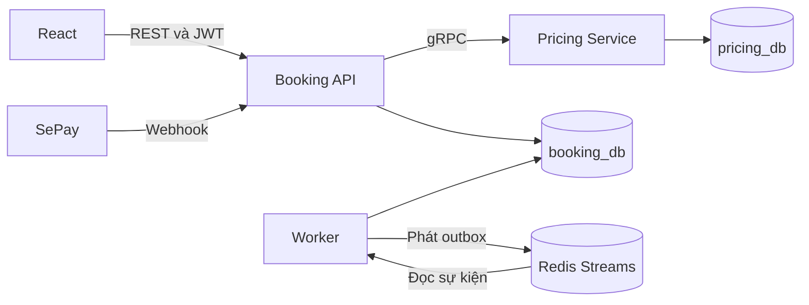

# SmartBooking Football

Ứng dụng đặt sân bóng cho User, Manager và Admin. Mỗi chi nhánh có tối đa ba sân. User cọc 50% qua VietQR/SePay để xác nhận lịch, staff check-in khách và ghi nhận khoản còn lại thu tại sân. Worker đánh dấu no-show khi quá giờ bắt đầu mười phút mà khách chưa check-in.

## Kiến trúc



Backend dùng ASP.NET Core .NET 8, EF Core/Pomelo, MySQL, gRPC và StackExchange.Redis. Booking API gọi Pricing qua hợp đồng [pricing.proto](Football_Booking/pricing.proto). Trong Docker Compose, Worker chạy thành tiến trình riêng từ cùng image Booking API. Worker đọc outbox để phát sự kiện, nhận sự kiện để tạo thông báo, hết hạn giữ chỗ và hoàn tất lịch đã qua giờ.

[Slide thuyết trình 14 trang](docs/presentations/SmartBooking_Final_50Percent_CheckIn.pptx) mô tả workflow, vai trò, C1, C2 và ERD sau migration 07: hai database, 10 bảng, 13 FK vật lý. Có thể nhập file PowerPoint vào Canva để chỉnh tiếp.

Booking API tổ chức theo ba lớp trong project `Football_Booking/Football_Booking`:

| Lớp | Trách nhiệm |
|---|---|
| [Api](Football_Booking/Football_Booking/Api) | Khai báo route REST, nhận dữ liệu HTTP, áp dụng chính sách xác thực/phân quyền và gọi service. |
| [Services](Football_Booking/Football_Booking/Services) | Xử lý đăng nhập, lịch đặt, báo giá, webhook, chức năng quản trị và tác vụ nền. |
| [Repositories](Football_Booking/Football_Booking/Repositories) | Giữ EF Core DbContext, cung cấp truy vấn và thao tác ghi, transaction và khóa booking. |

Ví dụ, `POST /api/bookings` đi qua `Endpoints` → `BookingService.Create` → `BookingRepository` → `BookingDb` → MySQL.

Frontend gửi `expectedAmountVnd` là giá khách vừa xem. Nếu Pricing Service trả giá khác, API trả `409` với `code: "PriceChanged"` và `amountVnd` để khách xác nhận trước khi giữ sân. Trường này là tùy chọn cho các client cũ.

## Chạy bằng Docker Compose

1. Đặt hai repo cạnh nhau với tên `SmartBooking-Football-BE` và `SmartBooking-Football-FE`.
2. Từ repo backend, chạy `./scripts/init-local-env.ps1`. Script tạo hoặc điền những biến còn trống trong `.env`, sinh mật khẩu MySQL/JWT/Admin và dùng tài khoản ngân hàng demo `0000000000` cho cấu hình mới. Các giá trị đã điền được giữ lại. File `.env` được Git bỏ qua. Đọc file trên máy để lấy thông tin Admin.
3. Chạy `docker compose config --quiet`, sau đó `docker compose up --build -d`. Compose local dùng MySQL trong Docker với `MYSQL_ROOT_PASSWORD`, `BOOKING_DB_PASSWORD`, `PRICING_DB_PASSWORD`. Lần đầu tạo volume, MySQL chạy script 01–07 và tạo tài khoản riêng cho từng schema.
4. Mở React tại `http://localhost:5173` và Swagger tại `http://localhost:5045/swagger`. Trong Swagger, gọi `POST /api/auth/login` rồi dán trường `token` vào nút **Authorize**.

## Deploy cloud bằng Render

Đề cho phép chọn triển khai cloud thay cho Docker Compose. Cấu hình triển khai Render đã có sẵn trong `render.yaml`; hướng dẫn từng bước nằm ở [RENDER-DEPLOY.md](RENDER-DEPLOY.md). Docker Compose vẫn chỉ giữ vai trò môi trường local/demo.

Với database đã có dữ liệu, áp dụng các migration còn thiếu theo [database/README.md](database/README.md). API/Worker mới cần script 07. Volume MySQL cũ tiếp tục dùng mật khẩu đã tạo cho volume đó. Giữ đúng các biến tương ứng trong `.env` khi khởi động lại.

## Kiểm thử tự động

Chạy `npm ci` trong repo frontend, sau đó chạy tại repo backend.

```powershell
./scripts/test.ps1
```

Script tạo stack QA với tên ngẫu nhiên và cổng loopback riêng, kiểm tra nâng cấp dữ liệu cũ, rồi chạy API và Chrome qua luồng của User, Manager, Admin. Cần Docker Desktop, Node.js và Google Chrome. Dùng `-ChromePath '<đường-dẫn-Chrome-hoặc-Chromium>'` nếu trình duyệt nằm ở nơi khác. Kiểm tra bao gồm JWT, scope chi nhánh, CRUD, gRPC, giữ sân đồng thời, cọc, webhook, Redis, check-in, thu tiền, no-show và hết hạn.

Stack QA được dọn sau test. Thêm `-KeepRunning` để giữ lại khi cần xem giao diện hoặc log. Cấu hình QA được lưu dưới `.artifacts/qa/` và được Git bỏ qua.

Sau khi commit cả hai repo, chạy `./scripts/package.ps1` để tạo ZIP từ source đã commit. Script loại file sinh tự động và từ chối đóng gói nếu Git đang theo dõi `.env`, `node_modules`, `bin/obj` hoặc `.vs`. Có thể truyền `-PresentationPath '<slide.pptx>'` để kèm slide và `-OutputFile '<đường-dẫn-mới.zip>'` để chọn tên file. ZIP chứa mã commit của cả hai repo.

## Chạy trực tiếp với MySQL local

Nếu dùng MySQL trên máy, chạy những script còn thiếu theo thứ tự `01-booking.sql` đến `07-deposit-check-in.sql`. Script 05 thống nhất tên bảng/cột, script 06 thêm ba chi nhánh với ba sân mỗi chi nhánh, script 07 bổ sung cọc, check-in, no-show và khôi phục giới hạn ba sân. Thời điểm được lưu theo UTC. Xem [thiết kế database](database/README.md).

Từ repo backend, mở ba terminal. Điền các giá trị trong dấu `<>` và chạy:

```powershell
# Terminal Pricing
$env:ConnectionStrings__Pricing='Server=127.0.0.1;Port=3307;Database=pricing_db;User ID=football_dev;Password=<mysql-password>;DateTimeKind=Utc'
dotnet run --no-launch-profile --project Football_Booking/Pricing
```

```powershell
# Terminal Booking API
$env:ConnectionStrings__Booking='Server=127.0.0.1;Port=3307;Database=booking_db;User ID=football_dev;Password=<mysql-password>;DateTimeKind=Utc'
$env:Jwt__Key='<random-value-at-least-32-bytes>'
$env:BootstrapAdmin__Email='admin@example.test'
$env:BootstrapAdmin__Password='<admin-password>'
$env:Sepay__Bank='Sacombank'
$env:Sepay__AccountNumber='<account-number>'
$env:Sepay__WebhookKey='<your-webhook-api-key>'
$env:ASPNETCORE_URLS='http://localhost:5045'
dotnet run --no-launch-profile --project Football_Booking/Football_Booking
```

```powershell
# Terminal Worker. Khởi động Redis 7 trước.
$env:ConnectionStrings__Booking='Server=127.0.0.1;Port=3307;Database=booking_db;User ID=football_dev;Password=<mysql-password>;DateTimeKind=Utc'
$env:ConnectionStrings__Redis='127.0.0.1:6379'
$env:RunMode='Worker'
$env:ASPNETCORE_URLS='http://localhost:5082'
dotnet run --no-launch-profile --project Football_Booking/Football_Booking
```

Trong repo frontend, chạy `npm ci` rồi `npm run dev`.

## SePay và kịch bản demo

Xem [checklist đối chiếu đề và kịch bản demo local](CHECKLIST-DEMO.md) để trình bày luồng thanh toán giả bằng script mà không cần URL công khai.

1. Admin đăng nhập, tạo chi nhánh, tạo Manager và phân công. Tại **Quản lý**, chọn chi nhánh và thêm tối đa ba sân. Manager đăng nhập và thêm bảng giá có hiệu lực trước hoặc vào ngày đá.
2. User đăng ký, chọn sân và slot, rồi tạo lượt giữ chỗ. Giữ tối đa 10 phút hoặc đến giờ bắt đầu, tùy mốc nào đến trước. Khoản cọc bằng 50% tổng tiền, làm tròn lên một VND, phần còn lại thu tại sân.
3. Điền ngân hàng và số tài khoản nhận tiền vào `SEPAY_BANK` và `SEPAY_ACCOUNT_NUMBER`. Chọn một chuỗi bí mật cho `SEPAY_WEBHOOK_KEY`, rồi cấu hình cùng chuỗi đó ở xác thực **API Key** trong webhook SePay. Luồng QR và webhook này dùng key xác thực webhook. SePay cần truy cập `POST /api/payments/sepay/webhook` qua URL HTTPS công khai. Khi demo cục bộ, trỏ tunnel tới cổng API 5045.
4. Trong SePay tạo webhook sự kiện **Có tiền vào**, chọn tài khoản nhận tiền tương ứng. Khi kiểm thử, gửi giao dịch giả lập có đúng mã trên trang booking và đúng số tiền, hoặc kiểm tra với môi trường Live sau khi cấu hình. [Webhook SePay](https://docs.sepay.vn/tich-hop-webhooks.html) · [Giả lập giao dịch](https://docs.sepay.vn/gia-lap-giao-dich.html)
5. Khi webhook tiền cọc hợp lệ đến trước lúc hết hạn, booking chuyển sang `Confirmed`, payment sang `Paid`, rồi Worker tạo thông báo. Manager đúng chi nhánh hoặc Admin mở chi tiết lịch, check-in khách và xác nhận số tiền đã thu tại sân. Quá mười phút sau giờ bắt đầu mà chưa check-in, Worker chuyển lịch sang `NoShow`, giữ tiền cọc và không thu phần còn lại. Các giao dịch sai tiền hoặc đến khi lịch đã đóng được lưu trong mục **Đối soát** của Admin.
6. Demo thêm các nhánh đặt trùng trả `409`, Manager truy cập chi nhánh khác trả `403` và Worker giải phóng slot quá hạn.
