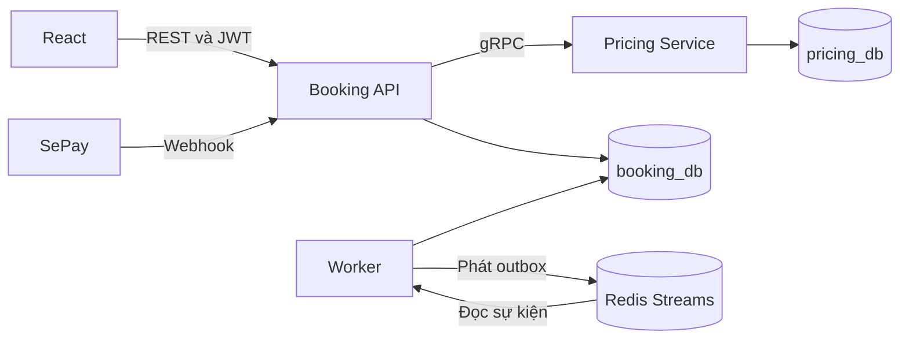

# SmartBooking Football

Ứng dụng đặt sân bóng cho User, Manager và Admin. Admin và Manager có thể thêm sân theo nhu cầu trong phạm vi quyền của mình. User đặt và thanh toán qua VietQR, Manager vận hành chi nhánh được giao, Admin quản lý toàn hệ thống.

## Kiến trúc



Backend dùng ASP.NET Core .NET 8, EF Core/Pomelo, MySQL, gRPC và StackExchange.Redis. Booking API gọi Pricing qua hợp đồng [pricing.proto](Football_Booking/pricing.proto). Worker chạy thành tiến trình riêng từ cùng image Booking API. Worker đọc outbox để phát sự kiện, nhận sự kiện để tạo thông báo, hết hạn giữ chỗ và hoàn tất lịch đã qua giờ.

Booking API tổ chức theo ba lớp trong project `Football_Booking/Football_Booking`:

| Lớp | Trách nhiệm |
|---|---|
| [Api](Football_Booking/Football_Booking/Api) | Khai báo route REST, nhận dữ liệu HTTP, áp dụng chính sách xác thực/phân quyền và gọi service. |
| [Services](Football_Booking/Football_Booking/Services) | Xử lý đăng nhập, lịch đặt, báo giá, webhook, chức năng quản trị và tác vụ nền. |
| [Repositories](Football_Booking/Football_Booking/Repositories) | Giữ EF Core DbContext, cung cấp truy vấn và thao tác ghi, transaction và khóa booking. |

Ví dụ, `POST /api/bookings` đi qua `Endpoints` → `BookingService.Create` → `BookingRepository` → `BookingDb` → MySQL.

## Chạy bằng Docker Compose

1. Đặt hai repo cạnh nhau với tên `SmartBooking-Football-BE` và `SmartBooking-Football-FE`.
2. Từ repo backend, sao chép `.env.example` thành `.env`. Điền ba mật khẩu MySQL riêng, `JWT_KEY` ít nhất 32 byte và mật khẩu Admin ít nhất 8 ký tự. Dùng chuỗi hex ngẫu nhiên ít nhất 24 ký tự cho `BOOKING_DB_PASSWORD` và `PRICING_DB_PASSWORD`; PowerShell có thể tạo từng giá trị bằng `[guid]::NewGuid().ToString('N')`. Điền ba biến `SEPAY_*` khi tích hợp SePay. File `.env` được Git bỏ qua.
3. Chạy `docker compose up --build -d`. Lần đầu MySQL chạy ba script schema và tạo tài khoản riêng cho từng database. Compose dùng volume riêng của dự án.
4. Mở React tại `http://localhost:5173` và Swagger tại `http://localhost:5045/swagger`. Trong Swagger, gọi `POST /api/auth/login` rồi dán trường `token` vào nút **Authorize**.

## Deploy cloud bằng Render

Đề cho phép chọn triển khai cloud thay cho Docker Compose. Cấu hình triển khai Render đã có sẵn trong `render.yaml`; hướng dẫn từng bước nằm ở [RENDER-DEPLOY.md](RENDER-DEPLOY.md). Docker Compose vẫn chỉ giữ vai trò môi trường local/demo.

## Chạy trực tiếp với MySQL local

Nếu dùng MySQL trên máy, chạy những script còn thiếu theo thứ tự `01-booking.sql` đến `06-demo-data.sql`. Script 04 bỏ giới hạn số sân; script 05 đưa toàn bộ tên bảng/cột về lower camel case như `pitchId`, `createdAt`, `branchManagers`; script 06 thêm dữ liệu demo gồm 3 chi nhánh, sân, giá và tài khoản demo. Thời điểm vẫn được lưu theo UTC nội bộ nhưng tên cột không gắn hậu tố `_utc`. Chạy MySQL với timezone UTC. Xem [thiết kế database](database/README.md).

Từ repo backend, mở ba terminal. Điền các giá trị trong dấu `<>` và chạy:

```powershell
# Terminal Pricing
$env:ConnectionStrings__Pricing='Server=127.0.0.1;Port=3307;Database=pricing_db;User ID=football_dev;Password=<mysql-password>;DateTimeKind=Utc'
dotnet run --no-launch-profile --project Football_Booking/Pricing
```

```powershell
# Terminal Booking API
$env:ConnectionStrings__Booking='Server=127.0.0.1;Port=3307;Database=booking_db;User ID=football_dev;Password=<mysql-password>;DateTimeKind=Utc'
$env:Jwt__Key='<random-value-at-least-32-bytes>'
$env:BootstrapAdmin__Email='admin@example.test'
$env:BootstrapAdmin__Password='<admin-password>'
$env:Sepay__Bank='Sacombank'
$env:Sepay__AccountNumber='<account-number>'
$env:Sepay__WebhookKey='<your-webhook-api-key>'
$env:ASPNETCORE_URLS='http://localhost:5045'
dotnet run --no-launch-profile --project Football_Booking/Football_Booking
```

```powershell
# Terminal Worker. Khởi động Redis 7 trước.
$env:ConnectionStrings__Booking='Server=127.0.0.1;Port=3307;Database=booking_db;User ID=football_dev;Password=<mysql-password>;DateTimeKind=Utc'
$env:ConnectionStrings__Redis='127.0.0.1:6379'
$env:RunMode='Worker'
$env:ASPNETCORE_URLS='http://localhost:5082'
dotnet run --no-launch-profile --project Football_Booking/Football_Booking
```

Trong repo frontend, chạy `npm ci` rồi `npm run dev`.

## SePay và kịch bản demo

Xem [checklist đối chiếu đề và kịch bản demo local](CHECKLIST-DEMO.md) để trình bày luồng thanh toán giả bằng script mà không cần URL công khai.

1. Admin đăng nhập, tạo chi nhánh, tạo Manager và phân công. Tại **Quản lý**, chọn chi nhánh và dùng **Thêm sân** để tạo số sân cần dùng. Manager đăng nhập và thêm bảng giá có hiệu lực trước hoặc vào ngày đá.
2. User đăng ký, chọn sân và slot, rồi tạo lượt giữ chỗ. Giữ tối đa 10 phút hoặc đến giờ bắt đầu, tùy mốc nào đến trước.
3. Điền ngân hàng và số tài khoản nhận tiền vào `SEPAY_BANK` và `SEPAY_ACCOUNT_NUMBER`. Chọn một chuỗi bí mật cho `SEPAY_WEBHOOK_KEY`, rồi cấu hình cùng chuỗi đó ở xác thực **API Key** trong webhook SePay. Luồng QR và webhook này dùng key xác thực webhook. SePay cần truy cập `POST /api/payments/sepay/webhook` qua URL HTTPS công khai. Khi demo cục bộ, trỏ tunnel tới cổng API 5045.
4. Trong SePay tạo webhook sự kiện **Có tiền vào**, chọn tài khoản nhận tiền tương ứng. Khi kiểm thử, gửi giao dịch giả lập có đúng mã trên trang booking và đúng số tiền, hoặc kiểm tra với môi trường Live sau khi cấu hình. [Webhook SePay](https://docs.sepay.vn/tich-hop-webhooks.html) · [Giả lập giao dịch](https://docs.sepay.vn/gia-lap-giao-dich.html)
5. Khi webhook hợp lệ đến trước lúc hết hạn, booking chuyển sang `Confirmed`, payment sang `Paid`, rồi Worker tạo thông báo. Các giao dịch sai tiền, đến khi lịch đã đóng hoặc đã thanh toán được lưu trong mục **Đối soát** của Admin. Phiên bản này cho phép hủy trực tiếp lịch đang giữ chỗ và để Admin xử lý đối soát thủ công.
6. Demo thêm các nhánh đặt trùng trả `409`, Manager truy cập chi nhánh khác trả `403` và Worker giải phóng slot quá hạn.

## Phân công

Điền tên thành viên theo các phần Booking API và MySQL, Pricing gRPC, SePay và Redis Worker, React, triển khai và demo.
